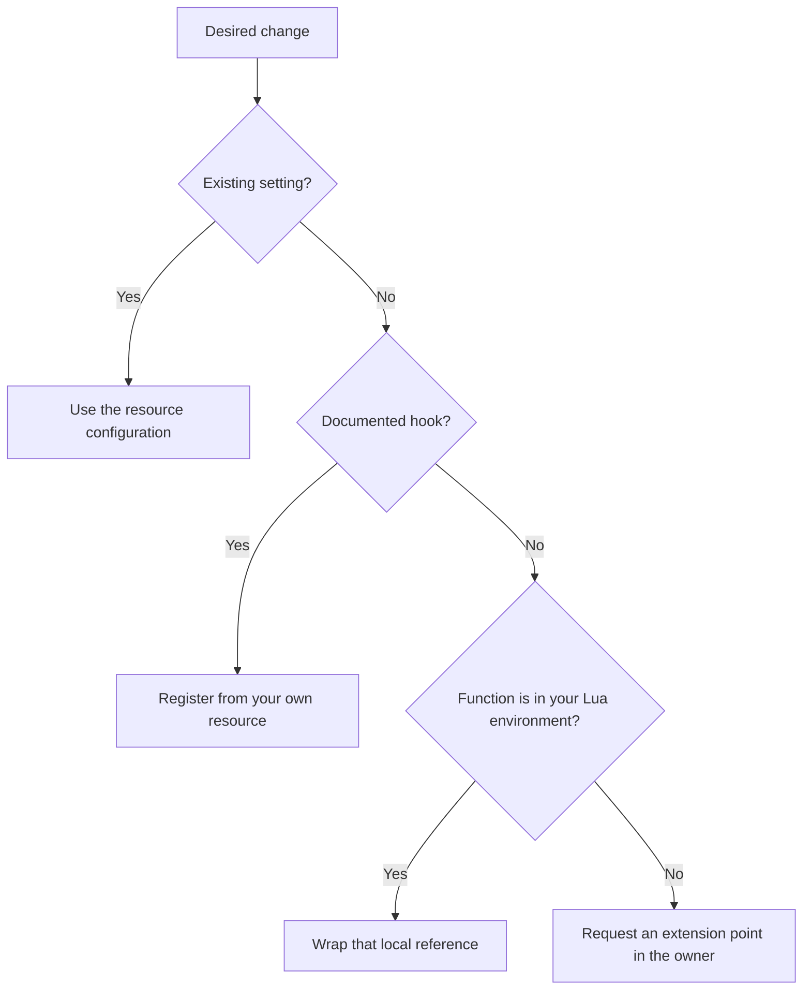
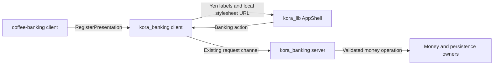
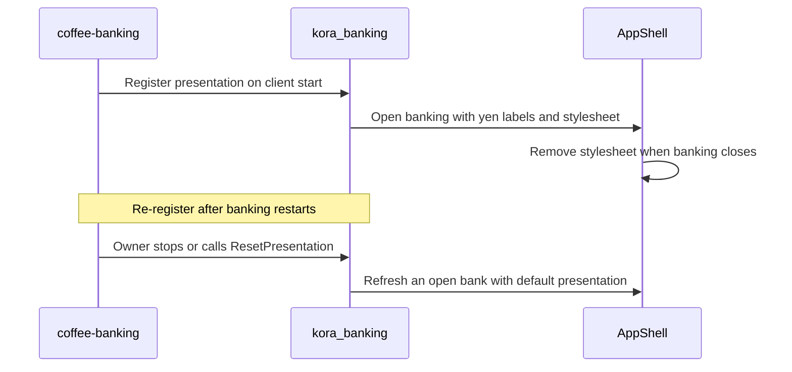

# Monkey patching and resource customisation

Keep server customisations in a separate resource so upstream updates do not
overwrite them. Use configuration for existing settings, exports for custom
integrations, and documented hooks for changes inside the owning resource.

A **monkey patch** replaces a function reference at runtime. It affects calls
through that reference. A **presentation hook** lets the owner apply your settings
through a supported API. Both can avoid maintaining a fork, but their scope differs.

## Choose the boundary



FiveM resources have separate Lua environments; client and server are separate too.
Defining a global in your resource does not replace another resource's private
function. Registering another event handler adds a listener, rather than replacing
the original handler or creating a veto hook.

## Example: wrap your resource's notification method

Load this patch after `@kora_lib/init.lua` and before your client scripts that use
notifications. Keep it in the resource whose calls you want to change:

```lua
local originalSend = Kora.notify.send

Kora.notify.send = function(payload, ...)
    if type(payload) ~= 'table' then
        return originalSend(payload, ...)
    end

    local branded = {}
    for key, value in pairs(payload) do
        branded[key] = value
    end
    if branded.title == nil then
        branded.title = 'My Server'
    end

    return originalSend(branded, ...)
end
```

The original function still validates and sends the notification. Copying the
payload preserves the caller's data; returning the original call preserves its
results. Calls from other resources, and references cached before the patch, bypass
this wrapper. Loading it in a standalone patches resource only changes that
resource's own method reference. Prefer an explicit helper when you control the
call sites.

## Worked example: Coffee Banking

`coffee-banking` is a separately maintained example resource. It uses banking's
presentation hook to display whole yen and apply a classic Windows desktop skin.
This is an example of extending a resource through its owner, rather than replacing
banking's private functions. Its source, stylesheet and installation README belong
in its own repository; the documentation site does not vendor them.

Install versions of `kora_banking` and `kora_lib` that support
`RegisterPresentation` / `ResetPresentation` and AppShell's local `stylesheet`
option. Older releases without those APIs cannot run the example unchanged.

The essential client registration is:

```lua
local ok, err = exports.kora_banking:RegisterPresentation({
    currencySymbol = '¥',
    title = 'Coffee Banking · JPY',
    stylesheet = 'https://cfx-nui-coffee-banking/web/windows97.css',
})
if not ok then
    Kora.logging.error('coffee_banking.presentation_failed', err)
end
```

Declare dependencies on `kora_banking` and `kora_lib` in the example's manifest,
import `@kora_lib/init.lua` before its client script, and publish
`web/windows97.css` in its `files` list. Start the example after banking:

```cfg
ensure kora_banking
ensure coffee-banking
```



An existing balance of 500 displays as ¥500. This changes denomination without an
exchange-rate conversion or database migration. Banking still owns PIN checks,
proximity, account access, limits and transaction handling. Currency displays in
other resources keep their own settings.

Scope CSS to `[data-kora-app="kora_banking:bank"]`. For floating listboxes and
dialogs, use the corresponding `data-kora-active-app` marker on AppShell's portal
host; do not change the host's theme variables. AppShell removes the stylesheet
when banking closes or another app opens.



One resource owns the presentation registration at a time. A conflicting owner is
refused. Stopping `coffee-banking` restores the defaults; starting it again
reinstalls the settings. The example also re-registers after banking restarts.
Server lifecycle logs confirm resource loading; client logs confirm presentation
registration or explain its failure.

## Check your customisation

- Test default and customised behavior, including refusal and failure paths.
- Restart the extension and its provider; check cleanup and re-registration.
- Confirm other resources retain their original behavior and theme.
- Keep money and permission checks on the server. A presentation patch is not an
  authorization boundary, and wrapping an export can change caller identity.

See [architecture and ownership](./architecture-standards.md) and
[Lua tooling](./lua-tooling.md) for implementation and review guidance.

Copyright © 2026 Kora Framework.
