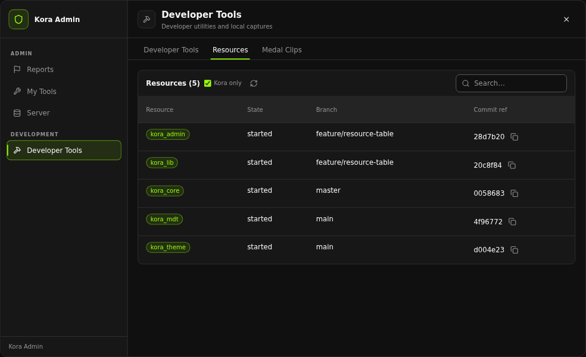
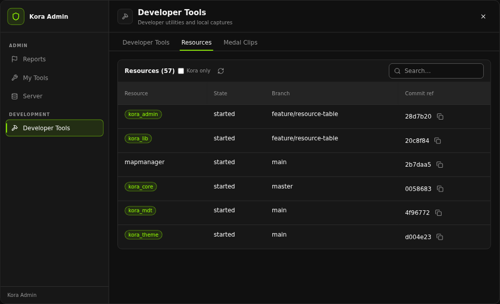

# Developer tools

The Developer Tools workspace in `/admin` (tabs Developer Tools, Resources and Medal Clips) is available to `Config.developer.menuLevel` (default `admin`). The menu runs the permission-checked commands `/entitypicker`, `/devplacement` and `/devzone`; their server handlers re-check the tier before relaying to the client.

## Development mode requirement

With `Config.developer.requireDevMode = true` (default `false`) the three tools also require the caller's kora_core development mode. The server refuses with "enable Kora Development Mode before using creator tools", and the menu buttons are disabled and labelled "(turn Development Mode on first)". In that mode the tab also shows a Turn Development Mode On / Off toggle for yourself, which runs `/devmode <your id>`.

## Entity picker

```text
/entitypicker
```

A focus-free inspector: aim at a prop, ped or vehicle and a kora_lib text UI panel (right centre) shows its type, label, model name, hash and distance. It fires an entity-only raycast and a catch-all raycast from the camera each frame (up to `Config.entityPicker.maxDistance` metres) and draws a centre dot (green over an entity) when `Config.entityPicker.crosshair` is on.

- For objects, GTA's archetype name is preferred so map props show their real model name even when they are not in kora_lib's catalogue. Peds and vehicles use the `Kora.lookup.model` name.
- `H` (`kora_admin_entitypicker_copy`) opens a kora_lib input dialog with the model name and a Copy Text button. If no name is known, the hash is reported instead.
- `X` (`kora_admin_entitypicker_close`) closes the picker.
- It refuses to start while kora_lib placement or the zone creator is active.

## Placement creator

```text
/devplacement <model or hash>
```

Starts `Kora.placement.start(model)` for any ped, vehicle or object (a model name matching `^[A-Za-z0-9_-]+$` or a numeric hash). When kora_lib returns a result kora_admin reports "Entity placement data copied"; otherwise "cancelled or unavailable". The preview is not persisted.

## Zone creator

```text
/devzone <box or sphere or poly>
```

Starts `Kora.zones.startCreator(type)`. The resulting definition is copied by kora_lib; no live zone is registered.

## Static entity spawning

The selected player's Advanced, Spawning group has **Spawn Ped / Prop** (`/entityfor`), and the Developer Tools tab has **Delete Last Spawned Entity** (`/deleteentity`). `/entity <model>` spawns one for yourself. These are local, static kora_lib entities, visible only to the receiving client. See [Commands](../commands.md#entities).

## Resources table

The Resources tab lists every resource on the server with its state and, when the resource folder is a Git checkout, the current branch and short commit reference. Data comes from the `kora_admin:menuResources` callback (admin only), which reads `.git` metadata (including worktree `gitdir:` files and `packed-refs`) from disk; nothing is executed.

- **Kora only** (header toggle, on by default) limits the list to `kora_` resources. Kora resources link to `https://github.com/KoraFiveM/<name>` and their commit to that repository's commit page.
- The commit cell shows the commit message (from the reflog, when available) and can copy the commit URL.
- The refresh button reloads the table. Both header controls require a kora_lib build that supports AppShell table header controls.





## Coordinates

`/coords` and `/vec4` (moderator) copy `vector3(...)` or `vector4(...)` of your position to the clipboard and always print it to the F8 console, so a failed clipboard write is never lost.
