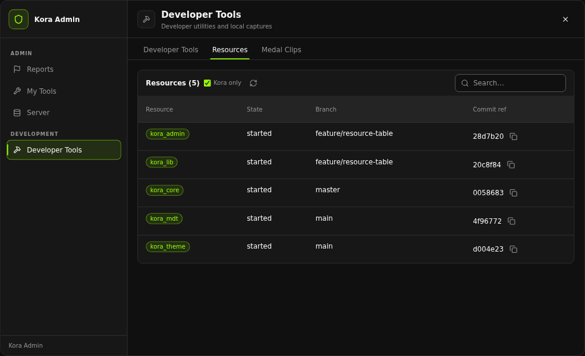

# Admin menu

`/admin` (default key `F7`) opens a kora_lib AppShell app titled "Administration" (`kora_admin:menu`). The menu never calls privileged server code directly: every action ends in `ExecuteCommand` with the same command a human would type, so the server's permission check, validation, audit entry and notification always run. Read-only data (player list, profiles, reports, audit log, resources, job/gang lists) comes from server callbacks that check permissions themselves.

Items your tier cannot use are hidden or disabled; this is presentation only. Actions with `visible` functions disappear when meaningless (for example Delete Vehicle while on foot with `Config.dv.nearestRadius = 0`); `disabled` functions keep an item visible but unusable (for example the developer tools before development mode when it is required). Actions that need the game view (teleports, spectate, noclip, appearance, developer tools) close the menu first. Destructive actions (ban, kick, kill, clear inventory, delete vehicle, restart resource, permission grants) ask for confirmation.

## Workspaces

| Workspace | Tabs | Minimum tier |
| --- | --- | --- |
| Players | Online (then the selected-player tabs) | support |
| Reports | Queue (then the selected-report tabs) | `Config.reports.staffLevel` |
| My Tools | General, Movement, Vehicles, Appearance | moderator |
| Server | Environment, Server, Offline Bans, Audit Log, Configuration | moderator for Server; admin for the others (Configuration: `Config.configEditor.level`) |
| Developer Tools | Developer Tools, Resources, Medal Clips | `Config.developer.menuLevel` / `Config.medal.menuLevel` |

A workspace appears only when at least one of its tabs is available to you.

### Players

The Online tab lists online players (id, name, job, ping) with search and a Refresh button. Selecting a player (including yourself) loads a fresh profile from the server and shows these tabs:

| Tab | Contents |
| --- | --- |
| Overview | Server id, name, citizen id, job and grade, gang and grade, money per account, health/armour, hunger/thirst, state (dead or last stand, handcuffed), ping. Admins also see permission level, license and Discord. **Copy Player Info** copies exactly the visible fields. **Warning History** runs `/warnings`. |
| Player Tools | Movement: Teleport to Player, Bring to Me, Send Back, Spectate. Health and State: Heal, Revive, Set Hunger, Set Thirst, Freeze/Unfreeze, God Mode, Invisibility toggles. Appearance: Open Clothing Menu, Open Barber / Hairdresser, Open Tattoo Menu. |
| Moderation | Warn, Kick, Ban (duration and reason), Kill. |
| Economy & Items | Give/Remove/Set Money (account, amount, reason), Give/Remove Item (item list from kora_core's shared items), Clear Inventory. |
| Roles & Access | Set Job, Set Gang (with dependent grade lists), Put On / Take Off Duty; Grant/Revoke Temporary Access; Grant/Revoke Permission (owner). |
| Advanced | Spawning: Spawn Vehicle (spawn code or catalogue), Add Personal Vehicle (code or catalogue, with plate), Spawn Ped / Prop. Development: Development Mode toggle. |

Toggle buttons show the current state and refresh after the server confirms a change. With `Config.menu.playerProfileHeaderBack = true` the per-player tabs show a header back arrow that behaves like Back to Online Players.

Job and gang lists come from kora_core's registry through the `kora_admin:menuRoles` callback (admin only), falling back to the client mirror. `Config.roles.hiddenJobs` and `hideDuplicateLabels` trim the job list only.

### Reports

See [Player reports](./features/reports.md). `/reports` opens the same queue as a standalone "Player Reports" app.

### My Tools

| Tab | Actions |
| --- | --- |
| General | Admin Duty toggle, Copy Coordinates, Set Health (0-100%, blank = full), Revive Me, Set Armor. |
| Movement | Teleport to Waypoint, Teleport to Coordinates, Teleport Back, Stop Spectating, Noclip toggle (admin). |
| Vehicles | Spawn from Code (`/car` with any valid GTA or streamed addon spawn code), Browse Vehicle Catalogue (searchable quick-pick of kora_core's shared vehicles; not an allow-list), Repair Current Vehicle, Delete Vehicle (admin). |
| Appearance | Open Wardrobe, Nearby Clothing / Barber / Tattoo Shop, Full Administrative Styling (admin). These fire kora_clothing client events and require kora_clothing to be running. |

### Server

| Tab | Actions |
| --- | --- |
| Environment | Send Announcement, Set Weather (list from kora_weathersync when running, else `Config.world.weatherTypes`), Dynamic Weather, Set Time (a preset from `Config.world.timePresets` or Custom exact time, prefilled with the current clock). |
| Server | Server Information, Restart Resource (owner). |
| Offline Bans | Ban Offline Player (citizen id or character name, duration, reason), Unban (license or ban id). |
| Audit Log | View Recent Activity and Filter Audit Log (action, target, page). Rows show action, actor, target, UTC time and details. |
| Configuration | Open Configuration Editor (kora_lib `Kora.config.open()`). |

Dynamic Weather runs `/freezeweather true` or `/freezeweather false`. kora_admin does not register that command; it must be provided by your weather resource (for example kora_weathersync).

### Developer Tools

| Tab | Contents |
| --- | --- |
| Developer Tools | Development Mode self toggle (only when `requireDevMode` is on), Inspect Entity, Place Entity / Model, Create Zone, Delete Last Spawned Entity. |
| Resources | Resource, state, Git branch and commit table. |
| Medal Clips | One button per `Config.medal.events` entry. |

See [Developer tools](./features/developer-tools.md) and [Medal clips](./features/medal-clips.md).

## Other NUI

- **My Reports** (`kora_admin:myreports`) - the player's report chat window, see [Player reports](./features/reports.md).
- **Medal bridge** - `web/medal.html` is the resource's `ui_page`; it is invisible and only relays Medal requests.
- **Noclip HUD** - kora_admin sends `noclip:hud` messages when noclip toggles.
- Entity picker and spectate hints use kora_lib text UI.

## Why screens are pushed with updateApp

kora_lib runs the menu's `onAction` handler from its own resource, so FiveM msgpack-encodes the returned table, and that encoder turns any table nested 16 or more levels deep into `nil`. In a returned `{ update = { navigation = ... } }` the Set Job / Set Gang grade options sit at exactly that depth. kora_admin therefore sends every `update` through `Kora.nui.updateApp` (two levels shallower) and returns only `navigate`, `notice` or `close`. Keep new screens on that path.
